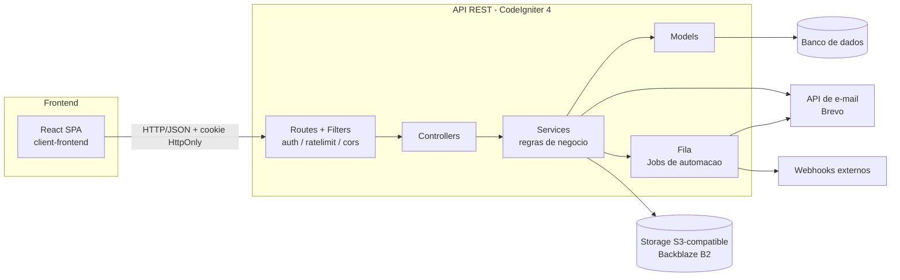
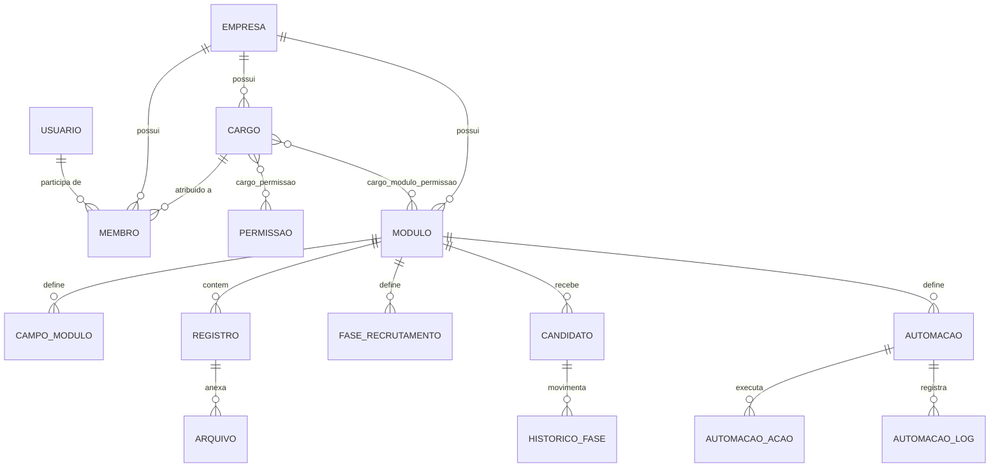
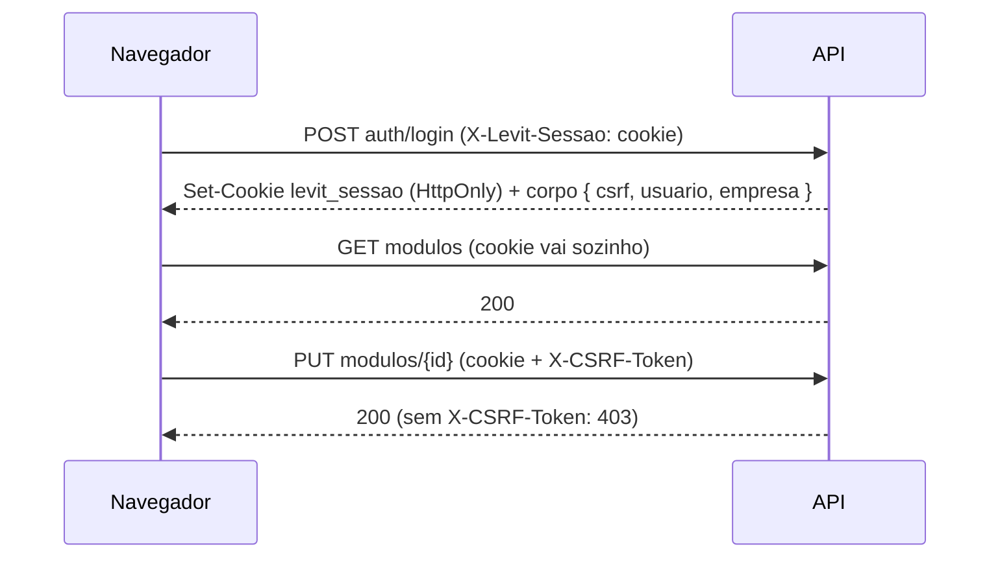

# Levit

Plataforma SaaS multi-tenant para criação de módulos de dados sob medida, com um módulo especializado de recrutamento (ATS) em formato Kanban.

O repositório é um monorepo simples com dois projetos independentes:

- **`api-backend/`** — API REST em PHP (CodeIgniter 4)
- **`client-frontend/`** — SPA em React (Vite)

---

## Sumário

- [Visão geral](#visão-geral)
- [Funcionalidades](#funcionalidades)
- [Tecnologias](#tecnologias)
- [Arquitetura](#arquitetura)
- [Estrutura do projeto](#estrutura-do-projeto)
- [Requisitos](#requisitos)
- [Instalação](#instalação)
- [Configuração](#configuração)
- [Banco de dados](#banco-de-dados)
- [Execução](#execução)
- [Testes](#testes)
- [API](#api)
- [Autenticação e autorização](#autenticação-e-autorização)
- [Segurança](#segurança)
- [Deploy](#deploy)
- [Limitações conhecidas](#limitações-conhecidas)
- [Licença](#licença)

---

## Visão geral

Cada empresa (`empresa`) que se cadastra na plataforma pode criar **módulos** próprios para organizar dados internos. Um módulo é uma entidade genérica e configurável pelo usuário, com três tipos possíveis:

- `dados` — módulo genérico com campos customizados (`campo_modulo`) e registros (`registro`) armazenados como JSON;
- `arquivo` — módulo voltado ao armazenamento de arquivos, com upload para um provedor compatível com S3;
- `recrutamento` — módulo especializado em vagas, com um Kanban de fases (`fase_recrutamento`) e um formulário público de candidatura para captar candidatos (`candidato`) sem exigir login.

Além disso, a plataforma oferece controle de equipe com cargos e permissões por empresa, automações disparadas por eventos em registros (envio de e-mail ou webhook) e rotinas de backup/exportação dos dados da empresa.

## Funcionalidades

- **Autenticação**: cadastro (`AuthController::registrar`, que cria a empresa e o usuário fundador), login e logout com revogação de token (`token_revogado`), recuperação e redefinição de senha.
- **Módulos customizados**: criação, edição e exclusão de módulos, com campos configuráveis e reordenação de campos.
- **Registros**: CRUD de registros dentro de um módulo, com dados armazenados em coluna JSON (`registro.dados`).
- **Upload de arquivos**: envio, download e exclusão de arquivos vinculados a um registro, armazenados em um serviço externo compatível com S3.
- **Recrutamento (Kanban)**: fases de recrutamento configuráveis por módulo, formulário público de candidatura com limitação de taxa (rate limit), quadro Kanban (por módulo e global), movimentação de candidatos entre fases com histórico (`historico_fase`).
- **Gestão de equipe**: convite de membros por e-mail, aceite de convite, listagem e remoção de membros, cargos (`cargo`) com permissões granulares (`permissao` / `cargo_permissao`).
- **Automações**: regras por módulo, disparadas por gatilhos em registros, com condições e ações encadeadas (`enviar_email` ou `webhook`), processadas de forma assíncrona via fila (`AutomacaoJob`/`ProcessarAutomacoes`) e registradas em log (`automacao_log`).
- **Backup e exportação**: exportação de todos os dados da empresa em JSON, exportação de um módulo específico em CSV, e reset de fábrica dos dados da empresa.

## Tecnologias

| Categoria             | Tecnologia                                             |
| ---------------------- | ------------------------------------------------------- |
| Linguagem (backend)     | PHP `^8.2`                                              |
| Framework (backend)     | CodeIgniter `^4.7`                                       |
| Autenticação             | `firebase/php-jwt ^7.1` (JWT)                           |
| Fila / jobs assíncronos  | `codeigniter4/queue ^1.0`                               |
| Armazenamento de arquivos | `aws/aws-sdk-php ^3.392` (Backblaze B2)                 |
| Envio de e-mail          | Integração HTTP com a API da Brevo (via Guzzle)          |
| Testes (backend)         | PHPUnit `^10.5`, PHPStan `^2.1`                          |
| Linguagem (frontend)     | JavaScript (React `^19.2`)                               |
| Build tool (frontend)    | Vite `^8.2`                                              |
| Roteamento (frontend)    | React Router `^7.18`                                     |
| HTTP client (frontend)   | Axios `^1.19`                                            |
| Estilos (frontend)       | Tailwind CSS `^4.3`                                       |
| Lint (frontend)          | ESLint `^10.8`                                            |
| Testes (frontend)        | Vitest `^5.0`, Testing Library                            |

O banco é PostgreSQL 18+, ver [Banco de dados](#banco-de-dados).

## Arquitetura

O backend segue a organização convencional do CodeIgniter 4 (MVC), com uma camada adicional de **serviços** concentrando as regras de negócio, os controllers (`app/Controllers`) delegam para classes em `app/Services`, que por sua vez usam os models (`app/Models`) para acesso a dados. Autenticação e autorização são resolvidas em um filtro de rota (`app/Filters/AuthFilter.php`), aplicado por grupo de permissão diretamente na definição de cada rota.



## Estrutura do projeto

```text
Levit-WEB/
├── api-backend/
│   ├── app/
│   │   ├── Controllers/     # Endpoints da API (auth, modulos, registros, candidatos...)
│   │   ├── Services/        # Regras de negocio (um servico por dominio)
│   │   ├── Models/          # Acesso a dados (um model por tabela)
│   │   ├── Filters/         # AuthFilter (JWT) e RateLimitFilter
│   │   ├── Jobs/            # Job de processamento de automacoes (fila)
│   │   ├── Database/
│   │   │   ├── Migrations/  # schema versionado
│   │   │   └── Seeds/       # PermissaoSeeder, CategoriaFinanceiraSeeder
│   │   ├── Config/          # Configuracao do framework (rotas, CORS, filtros, fila...)
│   │   └── Helpers/         # uuid_helper.php
│   ├── tests/                # PHPUnit (ver secao Testes)
│   ├── public/                # Document root (index.php)
│   └── composer.json
└── client-frontend/
    ├── src/
    │   ├── pages/            # Login, Register, Dashboard, Modules, RecrutamentoKanban, TeamManagement...
    │   ├── components/        # Layout, ProtectedRoute
    │   ├── context/           # AuthContext
    │   └── services/          # Clientes Axios por dominio (moduloService, equipeService...)
    └── package.json
```

## Requisitos

- PHP `>= 8.2`, com as extensões exigidas pelo CodeIgniter 4 (`intl`, `mbstring`, entre outras do próprio framework)
- [Composer](https://getcomposer.org/)
- Node.js, o Vite 8 exige Node.js `20.19+` ou `22.12+`
- npm (ou outro gerenciador de pacotes compatível com o `package-lock.json`)
- PostgreSQL 18+ (ver [Banco de dados](#banco-de-dados))
- Conta/credenciais em um provedor de e-mail (Brevo) e em um serviço de armazenamento compatível com S3 (Backblaze B2)

## Instalação

### 1. Clone o repositório

```bash
git clone <url-do-repositorio>
cd Levit
```

### 2. Backend — instale as dependências

```bash
cd api-backend
composer install
```

### 3. Backend — configure as variáveis de ambiente

Copie o modelo e preencha os valores (o `.env` não vai para o git):

```bash
cd api-backend
cp .env.example .env
```

O `.env.example` lista todas as variáveis lidas pelo código, ver [Configuração](#configuração). Sem as variáveis `B2_*`, a tabela de arquivos e os currículos não funcionam.

### 4. Backend — configure o banco de dados

Defina as credenciais de conexão no `.env` (ver [Banco de dados](#banco-de-dados)) e então execute as migrations e o seed de permissões:

```bash
php spark migrate
php spark db:seed PermissaoSeeder
php spark db:seed CategoriaFinanceiraSeeder
```

### 5. Frontend — instale as dependências

```bash
cd ../client-frontend
npm install
```

## Configuração

### Backend

Todas as variáveis estão em `api-backend/.env.example`, com comentários. Resumo:

| Variável | Finalidade | Obrigatória |
|---|---|:---:|
| `database.default.*` | Conexão PostgreSQL (`hostname`, `database`, `username`, `password`, `port`) | Sim |
| `JWT_SECRET_KEY` | Assina os tokens JWT. Gere com `php -r "echo bin2hex(random_bytes(32)), PHP_EOL;"`. Sem ela, a API não emite nem valida tokens. | Sim |
| `B2_ENDPOINT`, `B2_REGION`, `B2_BUCKET`, `B2_KEY_ID`, `B2_APPLICATION_KEY` | Storage S3 (Backblaze B2) da tabela de arquivos e dos currículos | Sim |
| `BREVO_API_KEY`, `BREVO_REMETENTE_EMAIL`, `BREVO_REMETENTE_NOME` | E-mail transacional (Brevo) | Com `EMAIL_PROVIDER=brevo` |
| `EMAIL_PROVIDER` | `brevo` (padrão) ou `log` (grava em `writable/logs`, para desenvolvimento) | Não |
| `FRONTEND_URL` | Origens liberadas no CORS (separadas por vírgula) e base dos links nos e-mails | Em produção |
| `SESSAO_COOKIE_SAMESITE` | `Lax` (padrão) com front e API no mesmo site; `None` em domínios diferentes (exige HTTPS) | Não |
| `SESSAO_COOKIE_SECURE` | Cookie só por HTTPS. Padrão: ligado em `production` | Não |
| `SESSAO_COOKIE_DOMINIO` | Domínio do cookie de sessão (padrão: o host da API) | Não |
| `FUSO_HORARIO`, `RESUMO_DIARIO_EMAIL` | Fuso das rotinas diárias e liga/desliga o resumo por e-mail | Não |

> [!WARNING]
> Nunca versione o `.env`. Se um segredo for commitado por engano, **troque-o**: apagar o arquivo não o remove do histórico do git.

### Frontend

`client-frontend/.env.example`:

| Variável | Finalidade | Padrão |
|---|---|---|
| `VITE_API_URL` | URL base da API | `http://localhost:8080/api/v1` |

## Banco de dados

O banco é **PostgreSQL 18+**: as migrations usam `uuidv7()` (função nativa a partir do 18) como chave primária e `jsonb` nos dados dos registros. `app/Config/Database.php` já vem com o driver `Postgre`; as credenciais ficam no `.env`.

As relações centrais:



Uma pessoa (`usuario`) pode estar em várias empresas: a ligação é a tabela `membro`, com o cargo dela em cada uma. O diagrama completo está em [`docs/diagrama-persistencia.md`](docs/diagrama-persistencia.md).

Depois das migrations, rode os seeders de permissões e de categorias financeiras:

```bash
php spark db:seed PermissaoSeeder
php spark db:seed CategoriaFinanceiraSeeder
```

## Execução

### Backend (desenvolvimento)

```bash
cd api-backend
php spark serve
```

Por padrão, a aplicação sobe em `http://localhost:8080/`, conforme `$baseURL` definido em `app/Config/App.php`.

Para processar a fila de automações (jobs assíncronos), é necessário rodar o worker da fila do CodeIgniter separadamente:

```bash
php spark queue:work automacoes
```

`automacoes` é o nome da fila usada pelos eventos de registro (`app/Config/Events.php`), com handler `database` (`app/Config/Queue.php`).

O `php spark serve` deste projeto (`app/Commands/Serve.php`) sobe o servidor com `upload_max_filesize=12M` e `post_max_size=13M`, porque o PHP padrão aceita só 2 MB e a tabela de arquivos aceita até 10 MB. Em Apache/Nginx com PHP-FPM, os mesmos valores vêm de `public/.user.ini`.

### Frontend (desenvolvimento)

```bash
cd client-frontend
npm run dev
```

O Vite inicia o servidor de desenvolvimento com hot-reload (porta padrão do Vite, não sobrescrita em `vite.config.js`).

### Build de produção do frontend

```bash
npm run build
npm run preview   # para pré-visualizar o build localmente
```

## Testes

O CI (`.github/workflows/`) roda tudo isto a cada push e pull request.

### Backend

```bash
cd api-backend
vendor/bin/phpstan analyse --memory-limit=1G   # análise estática, nível 6
vendor/bin/phpunit --no-coverage               # testes
composer audit --no-dev                        # vulnerabilidades em dependências
```

Os testes ficam em `tests/unit` e cobrem as regras puras dos services: filtros e condições de automação, gatilhos e webhooks, recorrência, prazos, indicadores, PDF dos relatórios, limites de cargo, sanitização e a sessão por cookie. Os 2 testes de `tests/database` usam SQLite em memória e precisam da extensão `sqlite3`.

Os testes de integração em `tests/integracao` passam por rotas, filtros, controllers e banco (autenticação, CSRF, isolamento entre empresas). Rodam no CI com `postgres:18`; localmente, só com o grupo de banco `tests` apontando para um PostgreSQL 18 (instruções no topo do arquivo de teste).

### Frontend

```bash
cd client-frontend
npm run lint
npm test          # Vitest + Testing Library
npm run build
```

## API

Todas as rotas ficam sob o prefixo `api/v1` (definidas em `app/Config/Routes.php`). Respostas seguem um envelope padrão (`app/Controllers/BaseApiController.php`):

```json
{ "status": "success", "data": { } }
```
```json
{ "status": "error", "message": "...", "errors": { } }
```

### Autenticação

| Método | Endpoint | Descrição | Autenticação |
|---|---|---|:---:|
| POST | `auth/registrar` | Cadastra empresa + usuário fundador | — |
| POST | `auth/login` | Autentica e abre a sessão | — |
| POST | `auth/forgot-password` | Envia o link de redefinição de senha | — |
| POST | `auth/reset-password` | Troca a senha com o token do e-mail | — |
| POST | `auth/logout` | Revoga o token e apaga o cookie | Sessão |
| GET | `auth/equipes` | Equipes da pessoa logada | Sessão |
| POST | `auth/equipes` | Cria uma equipe e entra nela | Sessão |
| POST | `auth/trocar-equipe` | Entra em outra equipe (novo token) | Sessão |

### Módulos, campos e registros

| Método | Endpoint                                    | Descrição                              |
| ------ | ---------------------------------------------| ----------------------------------------- |
| GET    | `modulos`                                     | Lista os módulos da empresa                |
| POST   | `modulos`                                     | Cria um módulo                             |
| GET    | `modulos/{uuid}`                               | Detalhes de um módulo                       |
| PUT    | `modulos/{uuid}`                               | Atualiza um módulo                          |
| DELETE | `modulos/{uuid}`                               | Exclui um módulo                            |
| POST   | `modulos/{uuid}/campos`                         | Adiciona um campo ao módulo                 |
| PUT    | `modulos/{uuid}/campos/reordenar`                | Reordena campos                             |
| PUT    | `modulos/{uuid}/campos/{uuid}`                   | Atualiza um campo                           |
| DELETE | `modulos/{uuid}/campos/{uuid}`                   | Exclui um campo                             |
| GET    | `modulos/{uuid}/registros`                       | Lista registros do módulo                   |
| POST   | `modulos/{uuid}/registros`                       | Cria um registro                            |
| PUT    | `modulos/{uuid}/registros/{uuid}`                 | Atualiza um registro                        |
| DELETE | `modulos/{uuid}/registros/{uuid}`                 | Exclui um registro                          |

### Arquivos

| Método | Endpoint                                     | Descrição              |
| ------ | ----------------------------------------------| ------------------------- |
| POST   | `modulos/{uuid}/arquivos`                       | Envia um arquivo          |
| GET    | `modulos/{uuid}/arquivos/{uuid}`                 | Baixa um arquivo          |
| DELETE | `modulos/{uuid}/arquivos/{uuid}`                 | Exclui um arquivo         |

### Recrutamento

| Método | Endpoint                                              | Descrição                              | Autenticação |
| ------ | -------------------------------------------------------| ----------------------------------------- | :-----------: |
| POST   | `publico/candidatura/{uuid}`                             | Envia uma candidatura (formulário público) | Rate limit apenas |
| GET    | `modulos/{uuid}/kanban`                                    | Kanban de candidatos de um módulo          | JWT           |
| GET    | `modulos/{uuid}/candidatos/{uuid}`                          | Detalhes de um candidato                   | JWT           |
| PUT    | `modulos/{uuid}/candidatos/{uuid}/fase`                     | Move o candidato de fase                   | JWT           |
| GET    | `recrutamento/kanban`                                        | Kanban global (todos os módulos)           | JWT           |
| PUT    | `recrutamento/candidatos/{uuid}/fase`                        | Move candidato de fase (Kanban global)      | JWT           |
| DELETE | `modulos/{uuid}/candidatos/{uuid}`                          | Exclui um candidato                        | JWT (`gerenciar_recrutamento`) |
| POST   | `modulos/{uuid}/fases`                                        | Cria fase de recrutamento                   | JWT (`gerenciar_modulos`) |
| PUT    | `modulos/{uuid}/fases/reordenar`                              | Reordena fases                              | JWT (`gerenciar_modulos`) |
| PUT    | `modulos/{uuid}/fases/{uuid}`                                | Atualiza fase                               | JWT (`gerenciar_modulos`) |
| DELETE | `modulos/{uuid}/fases/{uuid}`                                | Exclui fase                                 | JWT (`gerenciar_modulos`) |

### Equipe, cargos e automações

| Método | Endpoint                                      | Descrição                       |
| ------ | ------------------------------------------------| ---------------------------------- |
| GET    | `cargos`                                          | Lista cargos                        |
| POST   | `cargos`                                          | Cria cargo                          |
| POST   | `equipe/convidar`                                  | Convida um membro por e-mail        |
| GET    | `equipe`                                            | Lista membros da equipe             |
| DELETE | `equipe/{uuid}`                                    | Remove um membro                    |
| POST   | `publico/convite/aceitar`                            | Aceita um convite (público)         |
| POST   | `modulos/{uuid}/automacoes`                          | Cria automação                      |
| GET    | `modulos/{uuid}/automacoes`                          | Lista automações                    |
| PUT    | `modulos/{uuid}/automacoes/{uuid}/ativo`               | Ativa/desativa automação            |
| DELETE | `modulos/{uuid}/automacoes/{uuid}`                    | Exclui automação                    |

### Backup

| Método | Endpoint                          | Descrição                                       |
| ------ | ------------------------------------| -------------------------------------------------- |
| GET    | `backup/json`                        | Exporta todos os dados da empresa em JSON            |
| GET    | `modulos/{uuid}/exportar-csv`          | Exporta os registros de um módulo em CSV             |
| POST   | `backup/resetar`                     | Reseta os dados da empresa (irreversível)             |

## Autenticação e autorização



- **Navegador**: o JWT fica no cookie `levit_sessao`, `HttpOnly`, que o JavaScript da página não lê. Um XSS não consegue levar o token embora. Toda escrita autenticada por cookie exige o cabeçalho `X-CSRF-Token`, um HMAC do `jti` do token entregue no login. O front guarda só esse valor e os dados de exibição no `localStorage` (`app/Libraries/SessaoWeb.php`, `client-frontend/src/services/api.js`).
- **App Android e outros clientes**: sem o cabeçalho `X-Levit-Sessao: cookie`, o login devolve o token no corpo, e as chamadas usam `Authorization: Bearer <token>`, como antes.
- **Validação** (`app/Filters/AuthFilter.php`): assinatura e expiração (8 h), lista de revogados (`token_revogado`), troca de senha posterior à emissão (derruba sessões antigas) e vínculo atual com a equipe do token.
- **Autorização**: cada membro tem um `cargo` por equipe. O cargo tem permissões gerais (`cargo_permissao`, declaradas na rota, ex.: `auth:gerenciar_equipe`) e um nível por tabela (`visualizar`, `editar`, `gerenciar`), conferido nos services (`AutorizacaoModuloService`). Toda consulta filtra por `empresa_id`.
- **Rate limit** (`app/Filters/RateLimitFilter.php`): por IP e, no login e na recuperação de senha, também por e-mail.

## Segurança

- Senhas com bcrypt. O login gasta o mesmo tempo para e-mails inexistentes, para não revelar quais contas existem.
- Token de redefinição de senha guardado só como hash SHA-256, de uso único e com validade curta.
- Sessão em cookie `HttpOnly` + CSRF no navegador (ver acima).
- CORS restrito às origens de `FRONTEND_URL`.
- Cabeçalhos de segurança do CodeIgniter (`secureheaders`) em todas as respostas.
- Validação de entrada nos controllers e sanitização do conteúdo rico (`tests/unit/SanitizacaoTest.php`).
- `composer audit` e `npm audit` no CI.

## Deploy

1. Backend: `composer install --no-dev --optimize-autoloader`, `.env` de produção com `CI_ENVIRONMENT = production`, `php spark migrate` e os seeders. O document root é `api-backend/public`.
2. Worker da fila: `php spark queue:work automacoes`, mantido por um supervisor (systemd, Supervisor).
3. Rotinas diárias: agende `php spark rotinas:diarias` no cron.
4. Frontend: `VITE_API_URL=<url da API> npm run build` e sirva `client-frontend/dist` como SPA (todas as rotas caem no `index.html`).
5. Cookie de sessão: com front e API no mesmo site (ex.: `app.` e `api.` do mesmo domínio), o padrão `SameSite=Lax` basta. Em domínios diferentes, use `SESSAO_COOKIE_SAMESITE=None`.

## Limitações conhecidas

- Os testes de integração (`tests/integracao`) precisam de um PostgreSQL 18; sem ele, são pulados localmente e rodam só no CI.
- O frontend é JavaScript sem tipagem estática.

## Licença

MIT, ver [`api-backend/LICENSE`](api-backend/LICENSE).
