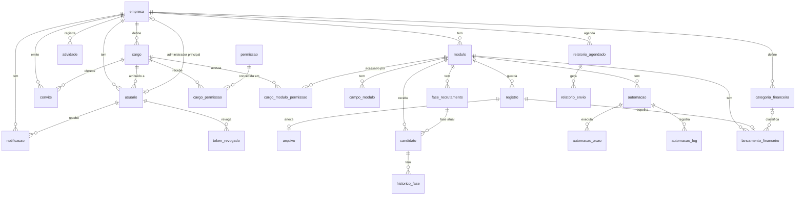
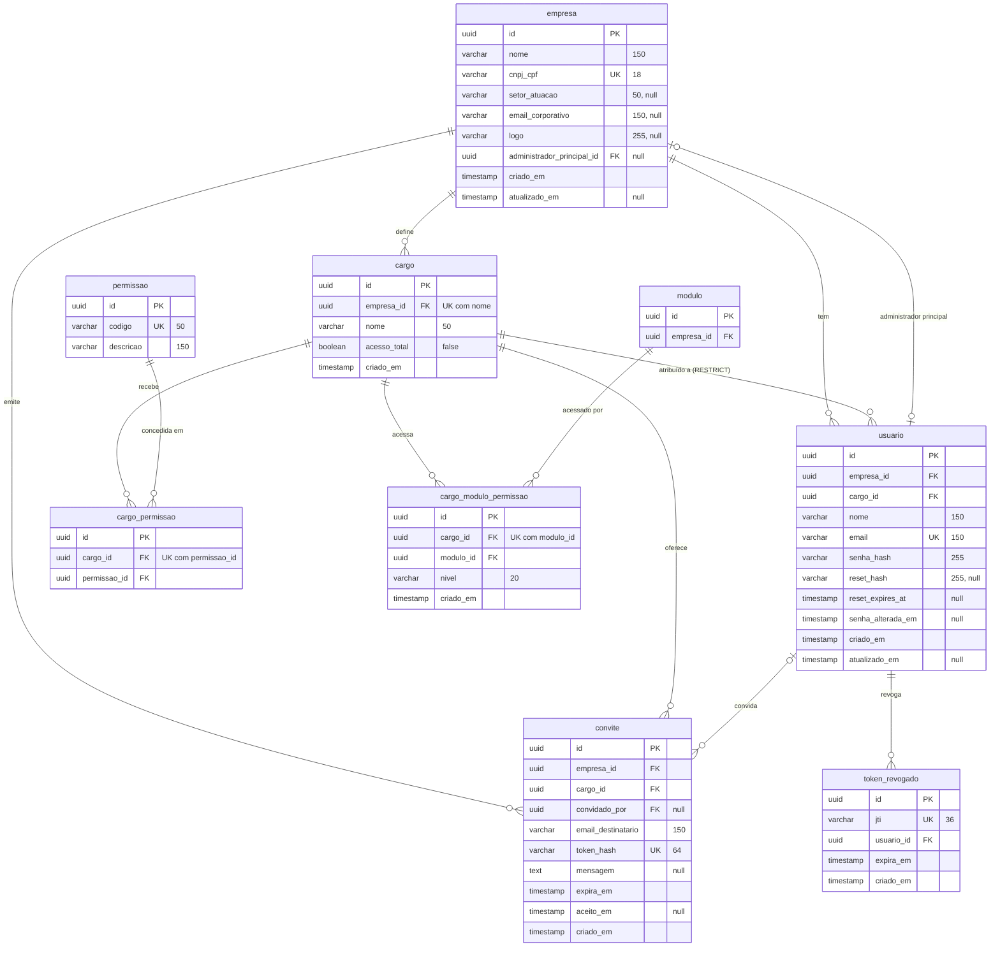
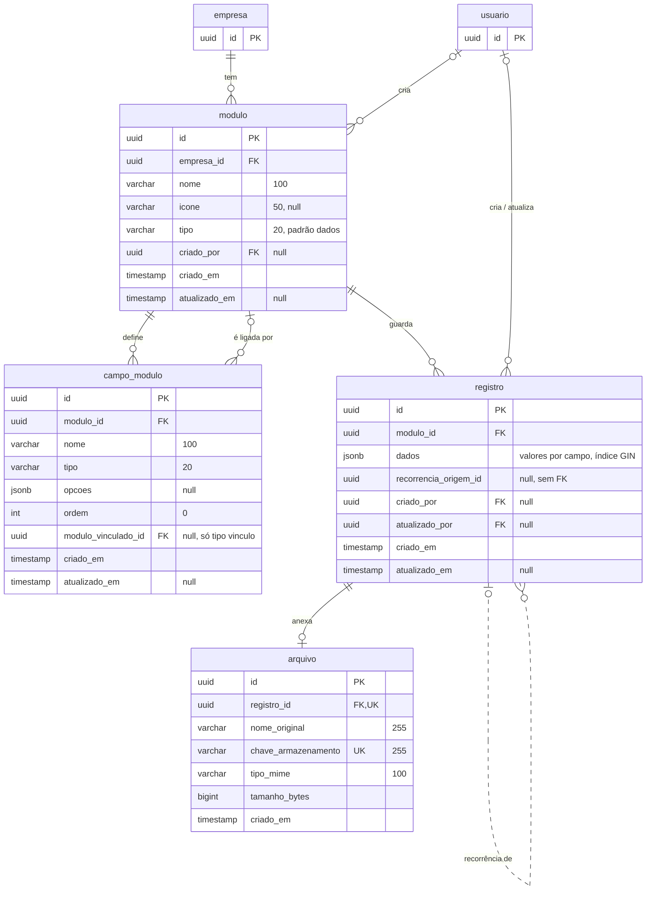
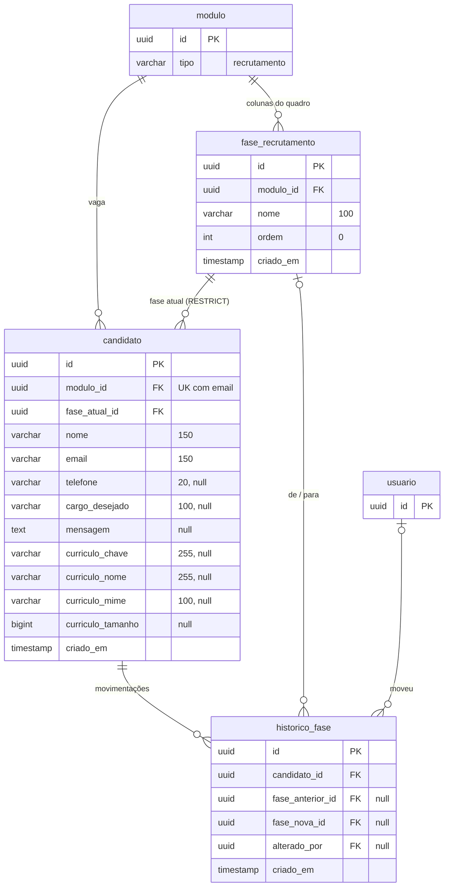
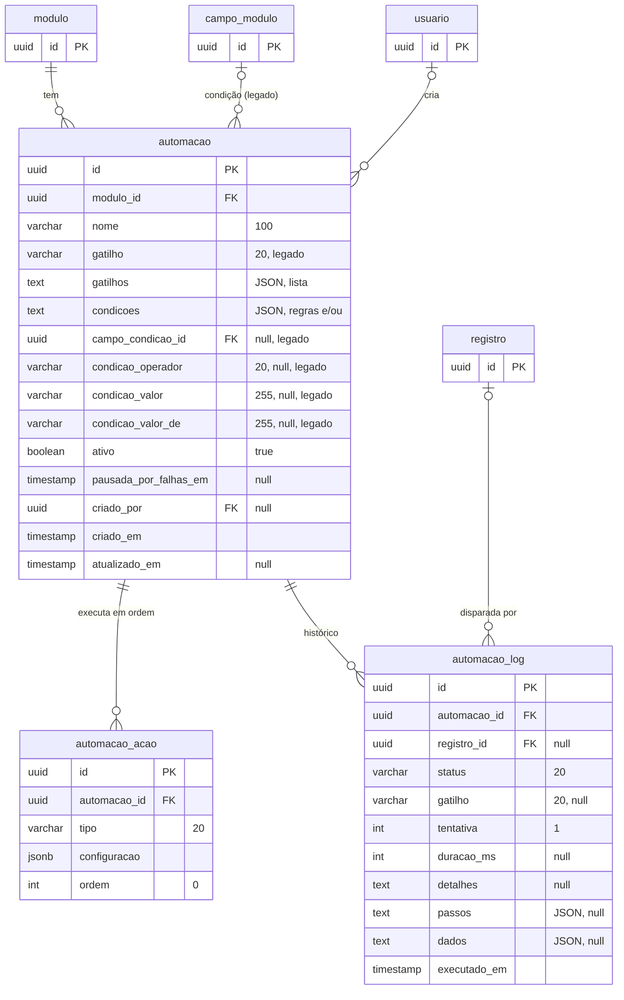
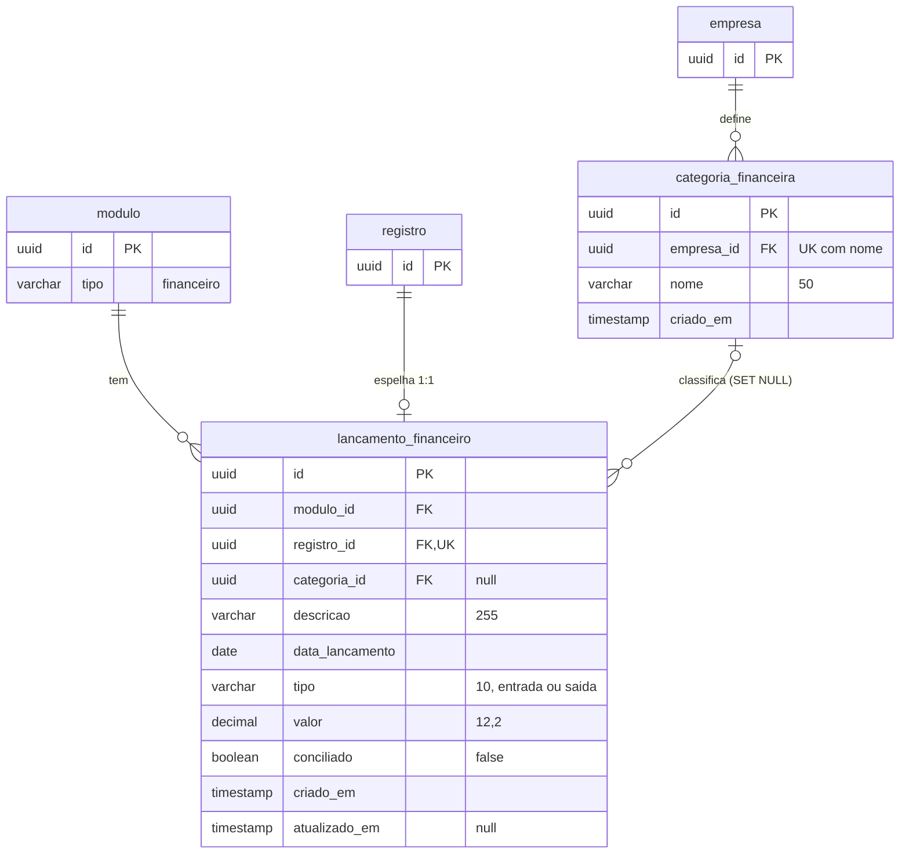
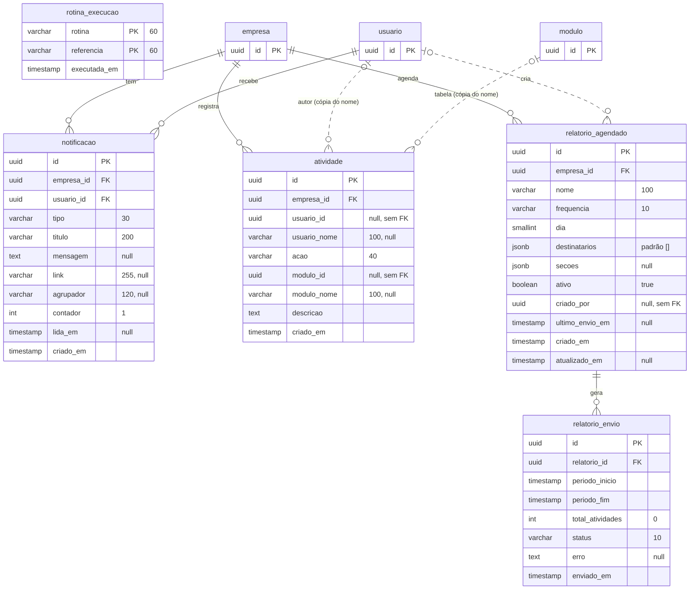

# Diagrama de persistência

Modelo do banco de dados (PostgreSQL) do Levit, reconstruído a partir das migrations em
`api-backend/app/Database/Migrations/` (estado após a última, `2026-10-26-120000_AddVinculoEntreTabelas`).

Convenções do esquema:

- Toda chave primária é `uuid` gerada por `uuidv7()` (exceto `rotina_execucao`, de chave composta).
- `criado_em` tem padrão `CURRENT_TIMESTAMP`; `atualizado_em` é preenchido pela aplicação.
- Isolamento por empresa (multi-tenant): toda informação pertence a uma `empresa`, direta ou indiretamente via `modulo`.
- Nos diagramas, linha contínua é chave estrangeira real; **linha tracejada é uma referência lógica sem FK no banco**
  (a coluna guarda o id, mas o banco não garante a integridade).

## Visão geral

`rotina_execucao` não se relaciona com nenhuma tabela: é o controle de idempotência das rotinas agendadas (cron).

## 1. Empresa, usuários e controle de acesso

- `permissao` é um catálogo global (permissões da empresa como um todo); o acesso a cada tabela fica em
  `cargo_modulo_permissao.nivel`. Um cargo com `acesso_total` ignora ambos.
- Excluir um cargo com usuários é bloqueado (`ON DELETE RESTRICT`).

## 2. Tabelas dinâmicas (módulos, campos e itens)

- `modulo.tipo` distingue tabelas comuns (`dados`) das especiais (`recrutamento`, `financeiro`).
- Os valores de cada item ficam em `registro.dados` (jsonb), indexados pelo id do `campo_modulo`;
  por isso não há uma tabela de valores por campo.
- **Tabelas ligadas:** uma coluna do tipo `vinculo` aponta para outra tabela (`campo_modulo.modulo_vinculado_id`,
  FK real) e guarda em `registro.dados` o id do item ligado — ou uma lista de ids quando `opcoes.multiplo` é
  verdadeiro (N:N). A ligação item → item é lógica (sem FK): a aplicação confere que o item existe ao salvar e,
  ao excluir um item, tira o id dele das colunas que apontavam para ele. Excluir uma tabela usada por outra é
  barrado. O índice GIN (`jsonb_path_ops`) em `registro.dados` atende às consultas por conteúdo (`@>`).
- **Pesquisa avançada:** `GET /modulos/{id}/registros?filtros=…` aceita condições em grupos E/OU que
  atravessam ligações nos dois sentidos (ex.: pedidos cujo cliente é de Recife; clientes sem nenhum pedido),
  traduzidas em subconsultas `EXISTS` por `App\Services\Pesquisa\Filtros`.
- **Onde as ligações aparecem:** `GET /modulos/{id}/registros/{item}/ligados` devolve o outro lado (num cliente,
  os pedidos dele); o relatório montado (`GET /relatorios/agrupar`) agrupa pelo item ligado ou por uma coluna da
  tabela ligada (`agrupar_por=ligacao>coluna`) e aceita os mesmos `filtros`; a ação de automação "Criar item"
  pode ligar o novo item ao que disparou (`configuracao.ligar_campo_id`).

## 3. Recrutamento

- Cada módulo do tipo `recrutamento` é uma vaga; um mesmo e-mail só se candidata uma vez por vaga.
- Uma fase com candidatos não pode ser excluída (`ON DELETE RESTRICT`).

## 4. Automações

- `gatilho` e as colunas `condicao_*` são o formato antigo (um gatilho, uma condição); as migrations de outubro
  copiaram esses dados para `gatilhos` e `condicoes`, que são os campos usados hoje.

## 5. Financeiro

## 6. Notificações, atividade e relatórios

- `atividade` guarda cópias de `usuario_nome` e `modulo_nome` de propósito: o registro continua legível
  depois que o usuário ou a tabela são excluídos, por isso não há FK nessas colunas.
- `notificacao.agrupador` + `contador` juntam notificações repetidas em uma só enquanto não forem lidas.

## Índices além das chaves

| Índice | Tabela (colunas) |
| --- | --- |
| `registro_modulo_criado_idx` | `registro (modulo_id, criado_em DESC)` |
| `registro_criado_por_idx`, `registro_atualizado_por_idx` | `registro (criado_por)`, `registro (atualizado_por)` |
| `registro_recorrencia_origem_idx` | `registro (recorrencia_origem_id)` parcial, não nulos |
| `usuario_email_lower_idx` | `usuario (LOWER(email))` |
| `usuario_cargo_idx` | `usuario (cargo_id)` |
| `candidato_fase_atual_idx` | `candidato (fase_atual_id)` |
| `candidato_modulo_criado_idx` | `candidato (modulo_id, criado_em)` |
| `convite_pendente_email_idx` | `convite (empresa_id, email_destinatario)` parcial, `aceito_em IS NULL` |
| `lancamento_modulo_data_idx` | `lancamento_financeiro (modulo_id, data_lancamento, criado_em)` |
| `automacao_campo_condicao_idx`, `automacao_criado_por_idx` | `automacao (campo_condicao_id)`, `automacao (criado_por)` |
| `automacao_log_automacao_executado_idx` | `automacao_log (automacao_id, executado_em)` |
| `automacao_log_registro_idx` | `automacao_log (registro_id)` |
| `notificacao_usuario_criado_idx` | `notificacao (usuario_id, criado_em DESC)` |
| `notificacao_nao_lidas_idx` | `notificacao (usuario_id, agrupador)` parcial, `lida_em IS NULL` |
| `notificacao_empresa_idx` | `notificacao (empresa_id)` |
| `atividade_empresa_criado_idx` | `atividade (empresa_id, criado_em DESC)` |
| `relatorio_envio_relatorio_idx` | `relatorio_envio (relatorio_id, enviado_em DESC)` |
| `token_revogado_expira_idx` | `token_revogado (expira_em)` |
